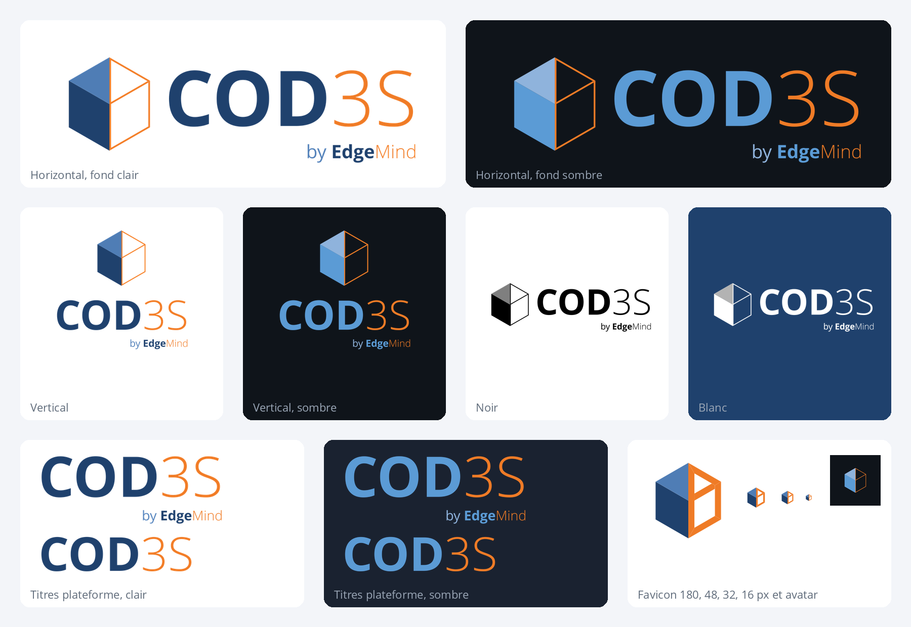

# Logo COD3S

COD3S est une sous-marque d'EdgeMind, signée « by EdgeMind ». Le logo a été arrêté le 07/11/2026, puis sa forme finale revue le 08/11/2026.



## Symbole

Un cube vu en perspective, coupé en deux dans la hauteur.

- La moitié gauche, pleine et bleue, représente le système réel.
- La moitié droite, réduite à ses arêtes orange, représente son jumeau numérique.

Les arêtes sont tracées à l'intérieur de la silhouette du cube : leur bord extérieur prolonge exactement le demi-cube bleu. Elles font 1,2 unité pour un symbole de 100 unités de côté.

## Logotype

« COD » en Open Sans Bold, bleu `#1F416D` (`#5B9BD5` sur fond sombre). « 3S » en Open Sans Light, orange `#EF7B26`. La signature « by EdgeMind » reprend le mot-symbole d'EdgeMind : « by » en Open Sans Regular, « Edge » en Bold et en bleu, « Mind » en Light et en orange.

Dans les fichiers à diffuser, le texte est vectorisé. `svg/cod3s_horizontal_light_source.svg` garde le texte modifiable.

## Fichiers

| Usage | Fichier |
|---|---|
| Document, présentation, fond clair | `cod3s_horizontal_light` |
| Fond sombre, instance en thème sombre | `cod3s_horizontal_dark` |
| Composition centrée (couverture, kakémono) | `cod3s_vertical_*` |
| Impression une couleur | `*_mono_black`, `*_mono_white` |
| Symbole seul | `cod3s_symbol_*` |
| Favicon | `svg/cod3s_favicon.svg` (s'adapte au thème du navigateur), `png/cod3s_favicon.ico` |
| Avatar de réseau social (recadrage rond) | `cod3s_avatar_light`, `cod3s_avatar_dark` |
| Titre sans symbole, avec signature (connexion, en-tête de la plateforme) | `cod3s_wordmark_*` |
| Nom seul, sans symbole ni signature (page d'accueil de la plateforme) | `cod3s_name_*` |

Chaque déclinaison existe en SVG (`svg/`) et en PNG (`png/`).

Le favicon épaissit les arêtes orange (5,5 unités) : à 16 px, les arêtes du symbole disparaîtraient.

## Affichage animé

Dans l'outil, le logo s'affiche en se construisant. Des nuées de petits points orange partent du demi-cube bleu et se déposent sur les arêtes du jumeau, qui deviennent pleines en 3 s environ. Cette construction est la même à chaque affichage : ce sont le nombre de points, leurs vitesses et leurs opacités qui donnent l'impression du hasard. Ensuite, des points filants bleu foncé parcourent les arêtes au hasard, un toutes les 4 s en moyenne. La forme finale est toujours le logo fixe.

La page `source/cod3s_twin_demo.html` montre cette animation. La plateforme COD3S la joue sur la carte de connexion (réglage `theme.logo_animation: twin_assembly`).

## Régénérer les fichiers

Les sources sont dans `source/` :

- `logo.js` : le générateur, utilisable sous Node comme dans un navigateur ;
- `glyphs.py` : la vectorisation du texte depuis `font_opensans/` ;
- `export_kit.cjs` : l'export de toutes les déclinaisons.

```bash
cd logos/cod3s/source
uv run --with fonttools --with uharfbuzz python glyphs.py glyphs.json
node export_kit.cjs
```

Les PNG se refont avec `rsvg-convert`, par exemple `rsvg-convert -w 512 svg/cod3s_symbol_light.svg -o png/cod3s_symbol_light_512.png`, puis la planche avec `uv run --with pillow python planche.py`.
